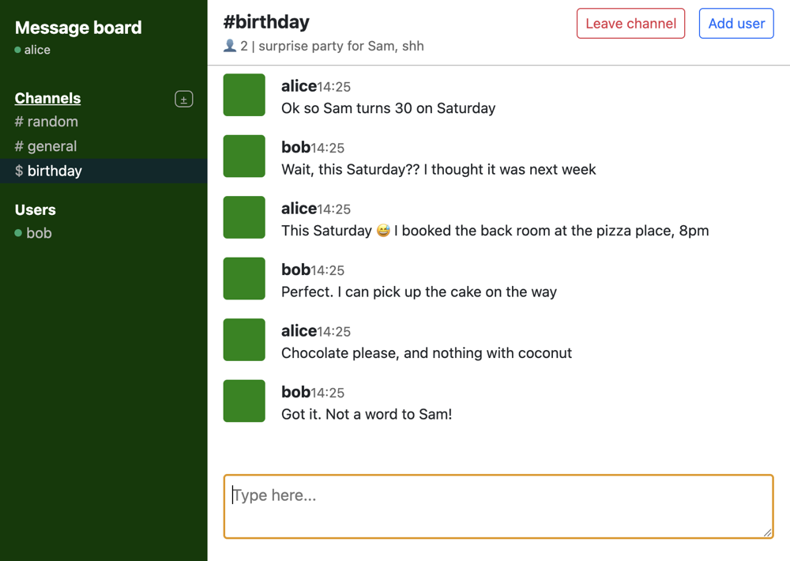

# E2E Chat

A desktop chat with end-to-end encrypted private channels and direct messages. The client is an Electron app, the server uses Node.js, Socket.IO and SQLite (Drizzle ORM).

The project started from an intentionally insecure chat application (no authentication, no encryption, no persistence) and was hardened for a university Security in Computing course.



## Features

- Accounts with bcrypt-hashed credentials. The password never leaves the client.
- Public channels, private channels and direct messages, stored in SQLite.
- Private channels and direct messages are end-to-end encrypted: the server only stores ciphertext.
- When someone leaves a private channel, a remaining member rotates the channel key.
- TLS between client and server, with the server's self-signed certificate pinned in the client.

## Getting started

Requirements: Node.js 20 or newer and OpenSSL.

Server:

```sh
cd server
npm install
npm run gen-cert     # self-signed certificate for localhost in server/certs/
npm start            # https://localhost:3000, database in chat.db
```

The database tables are created on startup from the migrations in `server/drizzle/`.

Client (in another terminal; run it twice to chat with yourself):

```sh
cd client
npm install
npm start
```

Register a user, then create a channel with the `+` next to *Channels*, or click on a user to send a direct message.

### Configuration

Server (`server/.env`, see `.env.example`):

| Variable | Default | |
| --- | --- | --- |
| `PORT` | `3000` | |
| `DB_FILE_NAME` | `chat.db` | SQLite file |
| `TLS_CERT`, `TLS_KEY` | `certs/cert.pem`, `certs/key.pem` | TLS certificate and key |

Client (environment variables):

| Variable | Default | |
| --- | --- | --- |
| `CHAT_SERVER` | `https://localhost:3000` | server address |
| `CHAT_CERT` | `../server/certs/cert.pem` | certificate the client trusts (pinned) |

## Tests

```sh
cd server
npm test
```

The tests start the real server over TLS on a temporary database and replay attacks against it:
- wrong passwords are rejected and the account is locked after 5 attempts,
- a user cannot add himself to a private channel or post in a room he is not in,
- malformed requests (unknown ids, wrong types, duplicate names) do not crash the server,
- plaintext is refused in private channels and direct messages,
- leaving a private channel triggers a key rotation that excludes the user who left,
- memberships and channel keys survive a server restart.

## Security design

### Trust model

- **Trusted:** the Electron client on the user's machine. It holds the decrypted private key in memory during a session.
- **Untrusted:** the server and its database. They never see plaintext private messages, passwords or private keys.
- **Untrusted:** the network.

### Cryptography

| What | How |
| --- | --- |
| Transport | TLS, the client only trusts the server's certificate (`ca` pinning) |
| Login | the client sends `PBKDF2-SHA256(password, "e2e-chat-auth:" + username, 100k)`; the server stores its bcrypt hash (cost 10) |
| User keys | RSA-2048 key pair generated on the client at registration |
| Private key storage | AES-256-GCM, key = PBKDF2-SHA256(password, random salt, 100k); the server stores the encrypted blob |
| Direct messages | a fresh AES-256-GCM key per message, encrypted with RSA-OAEP for both members |
| Private channels | one AES-256-GCM key per channel and version, encrypted with RSA-OAEP for each member |

### Threats and mitigations

| Attacker | Goal | Mitigation |
| --- | --- | --- |
| Impersonator | log in as someone else | password-derived credentials checked with bcrypt, lockout after 5 failed attempts |
| Network eavesdropper | read messages or steal a password | TLS with a pinned certificate, and private messages are end-to-end encrypted anyway |
| Compromised server or database | read private messages, steal passwords or keys | only ciphertext, bcrypt hashes and encrypted private keys are stored; the server never receives the password |
| Malicious user | join a private channel, post in other rooms, crash the server | membership checked on every request, all inputs validated, every handler catches its errors |
| XSS injector | run code through a message, username or channel name | messages are rendered with `textContent` only, and a Content Security Policy blocks inline scripts |
| Former channel member | read new messages of a channel he left | his keys are deleted and a remaining member generates a new key version; messages with the old key are refused |

Old key versions are kept, so the remaining members can still read the history.

### Limitations

- **The server distributes public keys.** A malicious server could swap them and read new messages (man in the middle). Fixing this needs key fingerprints that users compare out of band.
- **The server controls memberships.** A malicious server could add a fake member to a channel and receive the channel key at the next rotation.
- **No forward secrecy.** A channel key is only replaced when someone leaves.
- **Metadata is visible to the server:** who talks to whom and when, and the names of channels and users.
- **The renderer has Node.js access** (`nodeIntegration`, inherited from the original app). XSS is mitigated by `textContent` and the CSP, but moving to `contextIsolation` with a preload script would be safer.
- **Password policy is client-side only**, because the server only receives a derived secret.

## Project structure

```
.
├── server/
│   ├── src/index.js        # Socket.IO handlers, validation, access control
│   ├── src/rooms.js        # rooms, memberships, messages, channel keys
│   ├── src/users.js        # accounts, login and lockout
│   ├── src/db/schema.js    # Drizzle schema
│   ├── drizzle/            # SQL migrations
│   └── test/               # security tests
├── client/
│   ├── main.js             # Electron main process
│   └── public/             # login and chat pages, crypto in chat.js
└── docs/API.md             # Socket.IO messages
```

## Credits

Based on the *insecure-chat* skeleton by Jim Bauwens (MIT license), provided for the course.
